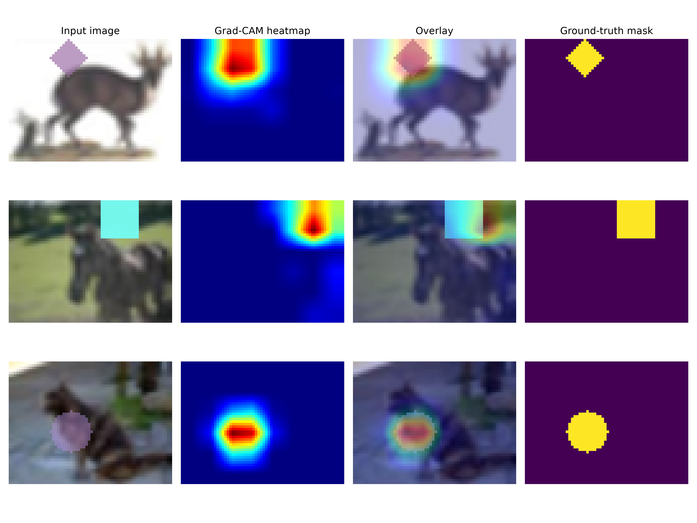

# Zero-Shot Shape Segmentation via Automated SAM Prompting


-lightgrey.svg)


## 1. Abstract & Objective
This project implements an automated, human-out-of-the-loop prompting pipeline for Meta's Segment Anything Model (SAM). The primary objective is to achieve zero-shot segmentation of geometric shapes by bridging the interpretability maps of a custom classifier with SAM's point-prompting mechanism. 

By utilizing Gradient-weighted Class Activation Mapping (Grad-CAM) on a fine-tuned ResNet18 backbone, the system deterministically extracts the spatial coordinates of high-relevance features. These coordinates are then dynamically fed into SAM as foreground and background prompts, effectively eliminating the need for manual user input when applying foundational vision models to specific tasks.

## 2. Architecture & Mathematical Formulation

The pipeline consists of two primary modules executing sequentially:

### 2.1 Saliency Extraction (Grad-CAM)
A ResNet18 model is trained to classify the target shape. To find the spatial location of the predicted class $c$, we compute the gradients of the class score $y^c$ with respect to the feature maps $A^k$ of the intermediate convolutional layer (e.g., `layer2[-1]`). 

The neuron importance weights $\alpha_k^c$ are calculated using global average pooling over the spatial dimensions (width and height, represented by $Z$):

$$ \alpha_k^c = \frac{1}{Z} \sum_i \sum_j \frac{\partial y^c}{\partial A_{ij}^k} $$

The final saliency map is a weighted combination of forward activation maps, passed through a ReLU activation to isolate features that have a positive influence on the class of interest:

$$ L_{Grad-CAM}^c = ReLU \left( \sum_k \alpha_k^c A^k \right) $$

### 2.2 Automated Prompting (SAM)
The resulting heatmap is normalized to a $[0, 1]$ range. We implement two programmatic prompting strategies:
*   **Approach 1 (Foreground Point Only):** Identifies the single pixel with the highest activation value $P_{fg} = \text{argmax}(L)$. This coordinate is passed to the SAM predictor as a positive "foreground" prompt.
*   **Approach 2 (Foreground & Background Points):** In addition to the maximum activation point, this method identifies the pixel with the lowest activation value $P_{bg} = \text{argmin}(L)$. Both coordinates are passed to SAM explicitly signaling the model which area to focus on and which to exclude.

## 3. Visualizations

The extraction of spatial features via Grad-CAM preserves the localization of the shapes. The heatmap effectively isolates the target geometry before point-prompt generation.



*Figure: From left to right: (1) Input image, (2) Generated Grad-CAM heatmap, (3) Overlay of heatmap on input, (4) Ground-truth segmentation mask. The red regions correspond to high activation values used to extract prompt points.*

## 4. Evaluation Metrics & Results

The performance of both pipelines was evaluated on the test dataset (100 samples) using three metrics: Intersection over Union (IoU), Point Hit Rate (percentage of foreground points falling strictly inside the ground truth mask), and Mean Distance (distance from the predicted point to the center of mass of the object). 

Testing on Apple Silicon (MPS) yielded the following improved metrics:

| Metric | Approach 1 (FG Only) | Approach 2 (FG + BG) |
| :--- | :--- | :--- |
| **Mean IoU** | **80.51%** | 79.76% |
| **Point Hit Rate** | 76.60% | 76.60% |
| **Mean Distance to Center** | 5.32 px | 5.32 px |

### Discussion and Potential Improvements
Both approaches demonstrated solid performance, significantly exceeding the target baseline threshold of 65% IoU. Approach 1 (Foreground Only) slightly outperformed Approach 2. This suggests that the "minimum activation" point is not always a reliable indicator of the background; it might fall on a boundary or an area of ambiguity, thereby introducing noise to SAM's prediction. 

**Future Work:** 
* Instead of a single peak point, sampling top-k points or using thresholding to generate a bounding box prompt could provide SAM with better spatial context. 
* Applying morphological operations (like dilation) to the Grad-CAM output before point selection could reduce noise and stabilize coordinates. 
* Aggregating feature maps from multiple layers of the ResNet backbone could yield more precise and fine-grained saliency maps.

## 5. Quick Start

This project uses `uv` for reproducible environment management and is compiled for fast execution.

```bash
# Clone the repository and sync dependencies
git clone https://github.com/Pavelpuff/sam-automated-prompting.git
cd sam-automated-prompting
make setup

# 1. Download dataset and pre-trained SAM ViT-B weights
make download-data
make download-weights

# 2. Train the ResNet18 classifier
make train

# 3. Generate Grad-CAM visualizations
make visualize

# 4. Evaluate SAM Pipeline
make evaluate-fg     # Run Approach 1 (Foreground Only)
make evaluate-both   # Run Approach 2 (Foreground + Background)
```